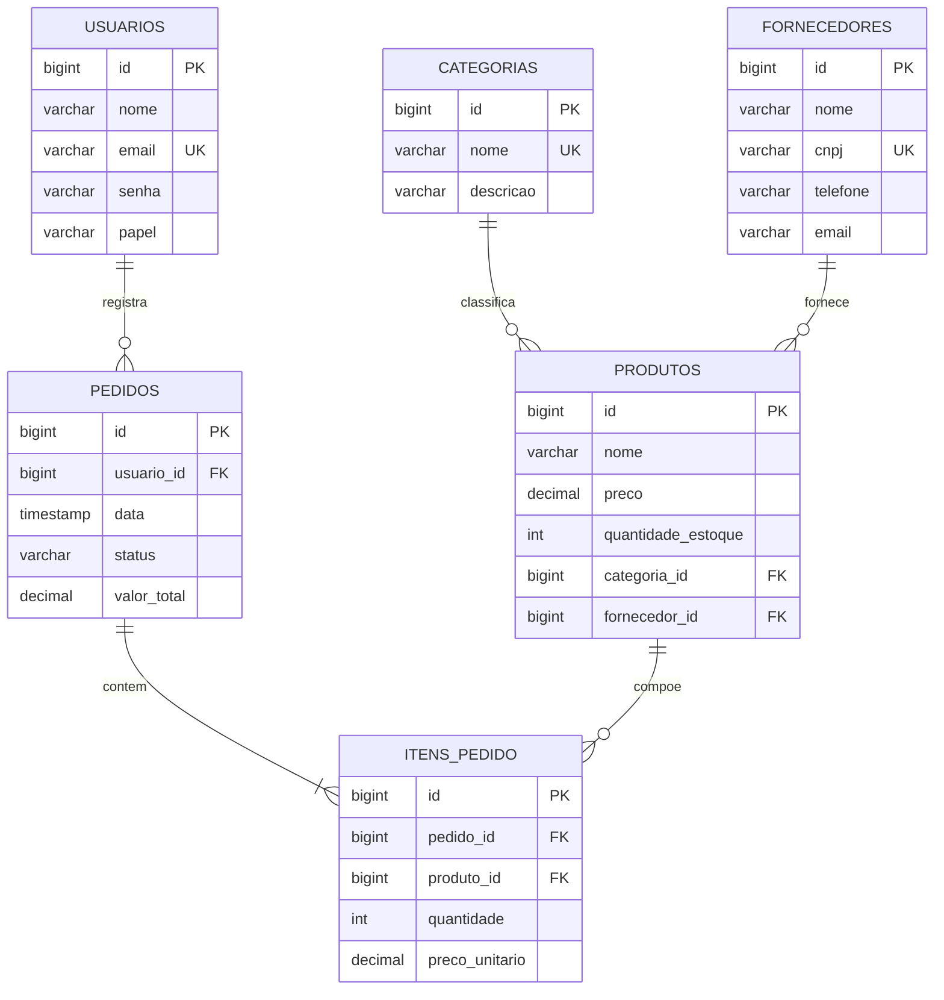

# Modelo de dados

## Entidades e relacionamentos
- `usuarios` 1:N `pedidos`: um usuário pode registrar vários pedidos.
- `categorias` 1:N `produtos`: cada produto pertence a uma categoria.
- `fornecedores` 1:N `produtos`: um fornecedor pode fornecer vários produtos; fornecedor é opcional.
- `pedidos` 1:N `itens_pedido`: um pedido possui vários itens.
- `produtos` 1:N `itens_pedido`: um produto pode aparecer em vários itens de pedidos.

## Decisões
- Valores monetários usam `BigDecimal`, evitando imprecisão de ponto flutuante.
- Relações `ManyToOne` são donas das chaves estrangeiras.
- `ItemPedido.precoUnitario` registra o preço no momento da venda, preservando o histórico.
- O status do pedido é enum: `PENDENTE`, `CONFIRMADO`, `CANCELADO`.
- O cadastro público não permite escolher papel: todo usuário novo recebe `FUNCIONARIO`.
